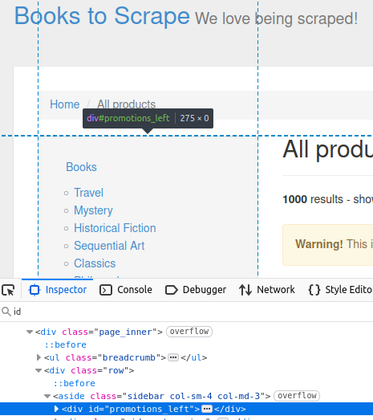
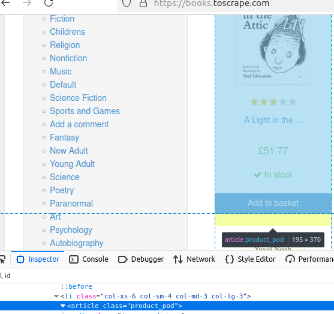
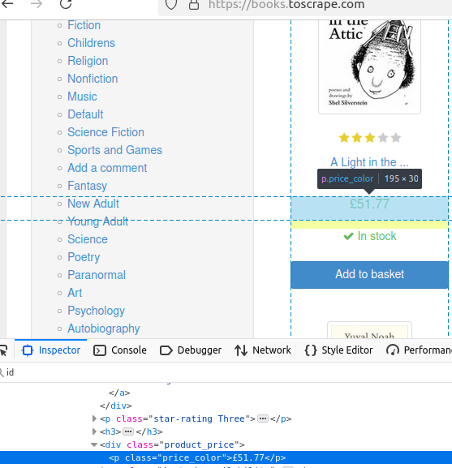

# 使用 jsoup 解析 HTML

[](https://www.bright.cn/) 

本指南介绍如何在 Java 中使用 `jsoup` 解析 HTML。你将学习如何使用 DOM 方法、处理分页并优化解析工作流。

- [使用 Jsoup 的 DOM 方法](#使用-jsoup-的-dom-方法)
  - [getElementById](#getelementbyid)
  - [getElementsByTag](#getelementsbytag)
  - [getElementsByClass](#getelementsbyclass)
  - [getElementsByAttribute](#getelementsbyattribute)
- [高级技巧](#高级技巧)
  - [CSS 选择器](#css-选择器)
  - [处理分页](#处理分页)
- [整合所有内容](#整合所有内容)

## 开始使用

本教程假定使用 [Maven](https://maven.apache.org/) 进行依赖项管理。

安装 Maven 后，创建一个名为 `jsoup-scraper` 的新 Java 项目：

```bash
mvn archetype:generate -DgroupId=com.example -DartifactId=jsoup-scraper -DarchetypeArtifactId=maven-archetype-quickstart -DinteractiveMode=false
```

要添加相关依赖项，请将 `pom.xml` 中的代码替换为以下代码：

```xml
<project xmlns="http://maven.apache.org/POM/4.0.0" xmlns:xsi="http://www.w3.org/2001/XMLSchema-instance"
  xsi:schemaLocation="http://maven.apache.org/POM/4.0.0 http://maven.apache.org/maven-v4_0_0.xsd">
  <modelVersion>4.0.0</modelVersion>
  <groupId>com.example</groupId>
  <artifactId>jsoup-scraper</artifactId>
  <packaging>jar</packaging>
  <version>1.0-SNAPSHOT</version>
  <name>jsoup-scraper</name>
  <url>http://maven.apache.org</url>
  <dependencies>
    <dependency>
      <groupId>junit</groupId>
      <artifactId>junit</artifactId>
      <version>3.8.1</version>
      <scope>test</scope>
    </dependency>
    <dependency>
        <groupId>org.jsoup</groupId>
        <artifactId>jsoup</artifactId>
        <version>1.16.1</version>
    </dependency>
  </dependencies>
  <properties>
    <maven.compiler.source>17</maven.compiler.source>
    <maven.compiler.target>17</maven.compiler.target>
</properties>
</project>
```

现在，将以下代码粘贴到 `App.java` 中：

```java
package com.example;

import org.jsoup.Jsoup;
import org.jsoup.nodes.Document;
import org.jsoup.nodes.Element;
import org.jsoup.select.Elements;

public class App {
    public static void main(String[] args) {

        String url = "https://books.toscrape.com";
        int pageCount = 1;

        while (pageCount <= 1) {

            try {
                System.out.println("---------------------PAGE "+pageCount+"--------------------------");

                //connect to a website and get its HTML
                Document doc = Jsoup.connect(url).get();
            
                //print the title
                System.out.println("Page Title: " + doc.title());
            
                
            } catch (Exception e) {
                e.printStackTrace();
            }
        }
        System.out.println("Total pages scraped: "+(pageCount-1));
    }
}
```

- `Jsoup.connect("https://books.toscrape.com").get()`：此行会获取页面并返回一个可供你操作的 `Document` 对象。
- `doc.title()` 返回 HTML 文档中的标题，在本例中为：`All products | Books to Scrape - Sandbox`。

## 使用 Jsoup 的 DOM 方法

`jsoup` 包含多种用于在 DOM（文档对象模型）中查找元素的方法。我们可以使用以下任一方法轻松查找页面元素。

- `getElementById()`：使用元素的 `id` 查找该元素。
- `getElementsByClass()`：使用 CSS 类查找所有元素。
- `getElementsByTag()`：使用 HTML 标签查找所有元素。
- `getElementsByAttribute()`：查找包含特定属性的所有元素。

### getElementById

在我们要抓取的网站上，侧边栏包含一个 `div`，其 `id` 为 `promotions_left`：



```java
//get by Id
Element sidebar = doc.getElementById("promotions_left");

System.out.println("Sidebar: " + sidebar);
```

此代码会输出你在检查页面中看到的 HTML 元素。

```
Sidebar: <div id="promotions_left">
</div>
```

### getElementsByTag

`getElementsByTag()` 可用于查找页面上带有特定标签的所有元素。在此页面中，每本书都包含在一个独有的 `article` 标签内：



以下代码会返回一个图书数组，为其余数据的提取奠定基础。

```java
//get by tag
Elements books = doc.getElementsByTag("article");
```

### getElementsByClass

我们来检查一本书的价格。其类为 `price_color`：



以下代码片段会查找 `price_color` 类的所有元素，并使用 `.first().text()` 输出第一个元素的文本：

```java
System.out.println("Price: " + book.getElementsByClass("price_color").first().text());
```

### getElementsByAttribute

我们使用 `getElementsByAttribute("href")` 查找所有带有 `href` 属性的元素：

```java
//get by attribute
Elements hrefs = book.getElementsByAttribute("href");
System.out.println("Link: https://books.toscrape.com/" + hrefs.first().attr("href"));
```

## 高级技巧

### CSS 选择器

要根据多个条件查找元素，可以将 CSS 选择器传递给 `select()` 方法。该方法会返回一个数组，其中包含与选择器匹配的所有对象。在下一个代码片段中，我们使用 `li[class='next']` 查找所有带有 `next` 类的 `li` 项：

```java
Elements nextPage = doc.select("li[class='next']");
```

### 处理分页

要处理分页，我们首先使用 `nextPage.first()` 获取数组中的第一个元素。然后对该元素调用 `getElementsByAttribute("href").attr("href")`，以提取其 `href` 值。

由于从第 2 页开始，链接中的 `catalogue` 一词会被移除，因此，如果链接不包含 `catalogue`，我们就将 `href` 添加回去。之后，将更新后的链接与基础 URL 组合，以获得下一页的 URL。

```java
if (!nextPage.isEmpty()) {
    String nextUrl = nextPage.first().getElementsByAttribute("href").attr("href");
    if (!nextUrl.contains("catalogue")) {
        nextUrl = "catalogue/"+nextUrl;
    } 
    url = "https://books.toscrape.com/" + nextUrl;
    pageCount++;
}
```

## 整合所有内容

以下是最终的 Java 代码。要抓取多个页面，只需更改 `while (pageCount <= 1)` 中的 `1`。例如，如果要爬取 4 个页面，请使用 `while (pageCount <= 4)`。

```java
import org.jsoup.Jsoup;
import org.jsoup.nodes.Document;
import org.jsoup.nodes.Element;
import org.jsoup.select.Elements;

public class App {
    public static void main(String[] args) {

        String url = "https://books.toscrape.com";
        int pageCount = 1;

        while (pageCount <= 1) {

            try {
                System.out.println("---------------------PAGE "+pageCount+"--------------------------");

                //connect to a website and get its HTML
                Document doc = Jsoup.connect(url).get();
            
                //print the title
                System.out.println("Page Title: " + doc.title());
            
                //get by Id
                Element sidebar = doc.getElementById("promotions_left");

                System.out.println("Sidebar: " + sidebar);

                //get by tag
                Elements books = doc.getElementsByTag("article");

                for (Element book : books) {
                    System.out.println("------Book------");
                    System.out.println("Title: " + book.getElementsByTag("img").first().attr("alt"));
                    System.out.println("Price: " + book.getElementsByClass("price_color").first().text());
                    System.out.println("Availability: " + book.getElementsByClass("instock availability").first().text());

                    //get by attribute
                    Elements hrefs = book.getElementsByAttribute("href");
                    System.out.println("Link: https://books.toscrape.com/" + hrefs.first().attr("href"));
                }

                //find the next button using its CSS selector
                Elements nextPage = doc.select("li[class='next']");
                if (!nextPage.isEmpty()) {
                    String nextUrl = nextPage.first().getElementsByAttribute("href").attr("href");
                    if (!nextUrl.contains("catalogue")) {
                        nextUrl = "catalogue/"+nextUrl;
                    } 
                    url = "https://books.toscrape.com/" + nextUrl;
                    pageCount++;
                }

            } catch (Exception e) {
                e.printStackTrace();
            }
        }
        System.out.println("Total pages scraped: "+(pageCount-1));
    }
}
```

编译代码：

```bash
mvn package
```

现在可以运行代码：

```bash
mvn exec:java -Dexec.mainClass="com.example.App"
```

以下是第一页的输出。

```
---------------------PAGE 1--------------------------
Page Title: All products | Books to Scrape - Sandbox
Sidebar: <div id="promotions_left">
</div>
------Book------
Title: A Light in the Attic
Price: £51.77
Availability: In stock
Link: https://books.toscrape.com/catalogue/a-light-in-the-attic_1000/index.html
------Book------
Title: Tipping the Velvet
Price: £53.74
Availability: In stock
Link: https://books.toscrape.com/catalogue/tipping-the-velvet_999/index.html
------Book------
Title: Soumission
Price: £50.10
Availability: In stock
Link: https://books.toscrape.com/catalogue/soumission_998/index.html
------Book------
Title: Sharp Objects
Price: £47.82
Availability: In stock
Link: https://books.toscrape.com/catalogue/sharp-objects_997/index.html
------Book------
Title: Sapiens: A Brief History of Humankind
Price: £54.23
Availability: In stock
Link: https://books.toscrape.com/catalogue/sapiens-a-brief-history-of-humankind_996/index.html
------Book------
Title: The Requiem Red
Price: £22.65
Availability: In stock
Link: https://books.toscrape.com/catalogue/the-requiem-red_995/index.html
------Book------
Title: The Dirty Little Secrets of Getting Your Dream Job
Price: £33.34
Availability: In stock
Link: https://books.toscrape.com/catalogue/the-dirty-little-secrets-of-getting-your-dream-job_994/index.html
------Book------
Title: The Coming Woman: A Novel Based on the Life of the Infamous Feminist, Victoria Woodhull
Price: £17.93
Availability: In stock
Link: https://books.toscrape.com/catalogue/the-coming-woman-a-novel-based-on-the-life-of-the-infamous-feminist-victoria-woodhull_993/index.html
------Book------
Title: The Boys in the Boat: Nine Americans and Their Epic Quest for Gold at the 1936 Berlin Olympics
Price: £22.60
Availability: In stock
Link: https://books.toscrape.com/catalogue/the-boys-in-the-boat-nine-americans-and-their-epic-quest-for-gold-at-the-1936-berlin-olympics_992/index.html
------Book------
Title: The Black Maria
Price: £52.15
Availability: In stock
Link: https://books.toscrape.com/catalogue/the-black-maria_991/index.html
------Book------
Title: Starving Hearts (Triangular Trade Trilogy, #1)
Price: £13.99
Availability: In stock
Link: https://books.toscrape.com/catalogue/starving-hearts-triangular-trade-trilogy-1_990/index.html
------Book------
Title: Shakespeare's Sonnets
Price: £20.66
Availability: In stock
Link: https://books.toscrape.com/catalogue/shakespeares-sonnets_989/index.html
------Book------
Title: Set Me Free
Price: £17.46
Availability: In stock
Link: https://books.toscrape.com/catalogue/set-me-free_988/index.html
------Book------
Title: Scott Pilgrim's Precious Little Life (Scott Pilgrim #1)
Price: £52.29
Availability: In stock
Link: https://books.toscrape.com/catalogue/scott-pilgrims-precious-little-life-scott-pilgrim-1_987/index.html
------Book------
Title: Rip it Up and Start Again
Price: £35.02
Availability: In stock
Link: https://books.toscrape.com/catalogue/rip-it-up-and-start-again_986/index.html
------Book------
Title: Our Band Could Be Your Life: Scenes from the American Indie Underground, 1981-1991
Price: £57.25
Availability: In stock
Link: https://books.toscrape.com/catalogue/our-band-could-be-your-life-scenes-from-the-american-indie-underground-1981-1991_985/index.html
------Book------
Title: Olio
Price: £23.88
Availability: In stock
Link: https://books.toscrape.com/catalogue/olio_984/index.html
------Book------
Title: Mesaerion: The Best Science Fiction Stories 1800-1849
Price: £37.59
Availability: In stock
Link: https://books.toscrape.com/catalogue/mesaerion-the-best-science-fiction-stories-1800-1849_983/index.html
------Book------
Title: Libertarianism for Beginners
Price: £51.33
Availability: In stock
Link: https://books.toscrape.com/catalogue/libertarianism-for-beginners_982/index.html
------Book------
Title: It's Only the Himalayas
Price: £45.17
Availability: In stock
Link: https://books.toscrape.com/catalogue/its-only-the-himalayas_981/index.html
Total pages scraped: 1
```

## 总结

抓取产品列表、新闻或研究数据等动态网站可能颇具挑战。[Bright Data 的工具](https://www.bright.cn/products)可帮助你大规模开展抓取工作：

- **[住宅代理](https://www.bright.cn/proxy-types/residential-proxies)：** 绕过 IP 封禁和地理限制。
- **[抓取浏览器](https://www.bright.cn/products/scraping-browser)：** 轻松处理大量使用 JavaScript 的网站。
- **[即用型数据集](https://www.bright.cn/products/datasets)：** 无需自行爬取即可获取结构化数据。

将这些工具与 jsoup 结合使用，可实现高效、低风险的数据提取。立即免费试用！
